Yeah everyone knows Rad Mobile because of the Sonic the Hedgehog rear-view mirror ornament, but there's a lot more underneath its hood.

<!--more-->

# Flicky Ornament

One of the first things you learn in Sega Fandom 101 is that Rad Mobile is the first video game appearance of Sonic the Hedgehog, six months before his official debut in his own title. So we won't belabor that point.

He appears as a rear-view mirror ornament, dangling and spinning as you wind your way across the USA.

What is slightly less known is that there also exists graphics for a different character: Flicky, Sega's erstwhile unofficial mascot.

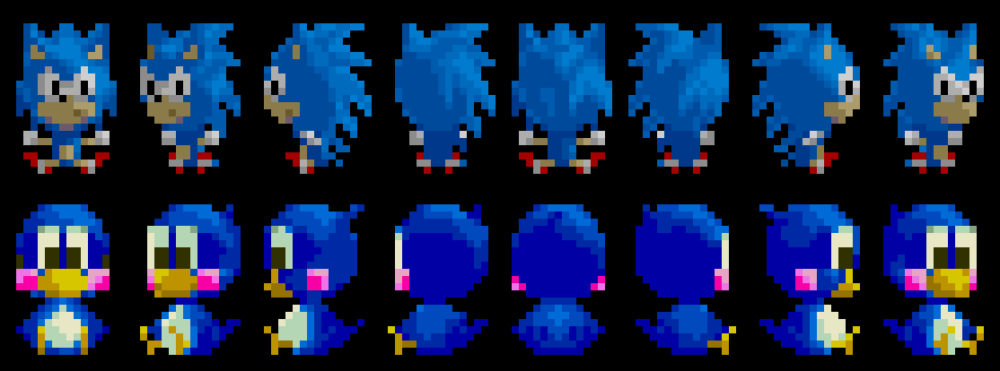

What is much less known is that these graphics are not cut content, but are actually selectable in the game.

The method is actually incredibly simple: **hold the Wiper and Lights buttons at the same time before a match starts while Start is not pressed**.

That may not seem like a problem... until you realize you have to press Start to begin the game. In other words, you have to very, very quickly tap the Start button while holding Wiper/Lights, such that the code registers that you want to start the game but the button state is cleared by the time it reaches the Flicky code check.

So how fast is that? Well with breakpoint magic, we find that there are 11 frames that pass from the Game Start check to the Flicky Code check. At 60 Hz, that's just over 1/6th of a second. But then things get worse.

The Flicky code check uses the input latch in RAM. This means it is not polling the I/O device directly, but relying on a cached copy of the button state from whenever it was last updated. On many games, that update occurs every VBLANK period, which is to say, on every frame. But Rad Mobile only updates those inputs on every *main loop iteration* which is a key difference. Of the 11 frames that pass from the title screen Start to the Flicky code check, there is only a 3 frame window where Start can be held.



Your window for letting go of the start button is about 50 milliseconds - faster than the blink of an eye and about the same speed as a nerve signal travelling from your toe to your brain. Ironically, you would need to be Sonic the Hedgehog himself to release the Start button fast enough.

That said, I have been able to trigger this in MAME by just *tapping and releasing start as fast as possible*. Whether the same can be done on an actual cabinet I can't say until I encounter one in real life... which seems vanishingly unlikely.

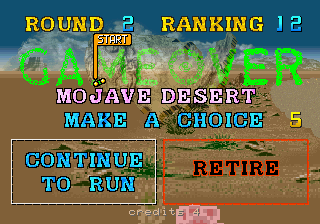

Now, there is another path to starting a a game without actually pressing Start: on the Game Over screen, make sure you have a credit and that Continue To Run is highlighted, then hold Wipers + Lights and simply let the countdown time out. It runs through the ornament initialization again, but this time you never actually hit Start, so the code check passes. Almost certainly not how it was intended to go, but it does work.

Or if you can't seem to get it working, you can always use a cheat:

World (`radm`):

```xml
  <cheat desc="Always use Flicky ornament">
    <comment>Does not require any extra input</comment>
    <script state="on">
      <action>temp0=mainpcb:maincpu.mw@073D57</action>
      <action>mainpcb:maincpu.mw@073D57=0xCDCD</action>
    </script>
    <script state="off">
      <action>mainpcb:maincpu.mw@073D57=temp0</action>
    </script>
  </cheat>
```

US (`radmu`):

```xml
  <cheat desc="Always use Flicky ornament">
    <comment>Does not require any extra input</comment>
    <script state="on">
      <action>temp0=mainpcb:maincpu.mw@073DAD</action>
      <action>mainpcb:maincpu.mw@073DAD=0xCDCD</action>
    </script>
    <script state="off">
      <action>mainpcb:maincpu.mw@073DAD=temp0</action>
    </script>
  </cheat>
```

## Is this a bug?

This feels broken. The code itself (hold Wipers + Lights) is so simple that it feels more akin to choosing a different color palette for a character in a fighting game. Yet the timing around the Start button makes it feel like some super-secret easter egg that isn't meant to be found by anyone except the dev who wrote it.

Here is where it the trouble happens:

<pre class="pdasm pdasm-arch-nec-v60" data-pdasm-caption="radmu (US)">
00073D98:  test.b  700A[R25]{is_credited}   ; are we interactive or in attract demo mode?
00073D9C:  be      00073DD5        ; in demo mode; don't do the Flicky code
00073D9E:  not.h   7018[R25], RH0  ; read the raw input latch and invert the bits so active is high
00073DA3:  and.h   #610, RH0     ; filter on Light, Wiper and Start buttons..
00073DA8:  cmp.h   #600, RH0     ; but check that only Light/Wiper are pressed and that Start is clear!
00073DAD:  bne     00073DD5        ; inputs didn't match; keep Sonic and start the game
00073DAF:  movea.b 7E84A{gfx__ornament_flicky}, R10      ; pointer to the Flicky graphics...
00073DB6:  movz.hw [R10+], R1      ; and the data length in words...
00073DB9:  movz.hw 00103DDE, R11
00073DC0:  movea.w 400000(R11), R11
00073DC8:  movcu.h [R10]R1, [R11]R1  ; overwrite the Sonic graphics loaded earlier in sprite RAM
00073DCE:  mov.h   #14F0, 4[R20]   ; and switch to the Flicky palette
</pre>

The actual code check begins at `0x73D9E`: two bitwise operations and a compare. First, a read of raw input, cached from RAM, as we discussed above. Raw I/O like this gives a logically inverted bitmap, where 1 means off and 0 means on; so that gets flipped with a `NOT`.

Next, the `AND` filters out inputs we don't want to check. In this arrangement, bit 4 is Start, bit 6 is Lights and bit 8 is wiper, giving us a mask of 0x610. The input value is is "pushed through" this mask, resulting in only the set bits (pushed state) of those three buttons. Then, a `CMP` to compare the buttons against the expected input value for the Flicky code: 0x600, which is Lights/Wiper only; the Start bit is clear. The comparison is all-or-nothing: if the Start bit is set, the values do not match, and the Flicky code fails.

I am entirely certain this is a bug that somehow didn't get caught before release. (Maybe the devs have really quick fingers after skipping through same parts of the game 500 times in testing...?)

My primary support for this assertion comes from Gale Racer, the port of Rad Mobile to the Sega Saturn. In that version, the Flicky ornament and its selection code have been known for a very long time. The code is simply **hold A + B + Start before the race begins**.

That is remarkably similar to the original arcade version, with the obvious difference being that it expects Start to be *pressed* rather than specifically *not pressed*.

Since Start is part of the code for the Saturn version, I strongly feel it was part of the original code in Rad Mobile. The compare mask should be 0x610, not 0x600, and we can fix it with a cheat:

World (`radm`)

```xml
  <cheat desc="Restore Flicky ornament code">
    <comment>Hold Lights + Wipers + Start buttons before the race begins</comment>
    <script state="on">
      <action>temp0=mainpcb:maincpu.mw@073D55</action>
      <action>mainpcb:maincpu.mw@073D55=0x0610</action>
    </script>
    <script state="off">
      <action>mainpcb:maincpu.mw@073D55=temp0</action>
    </script>
  </cheat>
```

US (`radmu`)

```xml
  <cheat desc="Restore Flicky original ornament code">
    <comment>Hold Lights + Wipers + Start buttons before the race begins</comment>
    <script state="on">
      <action>temp0=mainpcb:maincpu.mw@73dab</action>
      <action>mainpcb:maincpu.mw@73dab=0x0610</action>
    </script>
    <script state="off">
      <action>mainpcb:maincpu.mw@73dab=temp0</action>
    </script>
  </cheat>
```

There it is. Functionality exactly like the Saturn version and likely how it was originally intended.

# More Ornaments!

Turns out the Saturn port, Gale Racer, has even *more* rear-view mirror ornaments. Aside from the base Sonic ornament (which was redrawn to a more contemporary style to replace his stringy [first generation UFO Catcher prize](img/stringy_boy.jpg) look), there are *ten* additional Sonic series characters.

[Rings of Saturn already did an excellent writeup](https://32bits.substack.com/p/bonus-more-sonic-in-gale-racer) about this, so head over there for the details.

# One More Ornament...

We're not done with the rear-view mirror ornaments quite yet.

You see, both Sonic and Flicky were relatively late additions to the game. We know this because their graphics live in the program code, stored on flashable EEPROM, and not with the rest of the graphics on permanent mask ROM.

Basically, the game was far enough along that the artwork had already been completed and the lithography to produce the graphics mask ROMs en masse was complete or well underway. The game was probably in its final testing phase when someone had the idea to add in this new mascot that everyon was buzzing about, the new face of Sega.

That alone is a kind of neat fact, but there's more. The graphics for Sonic and Flicky are in program ROM, while the chain that they hang from *is not*. It's in mask ROM with the rest of the graphics. Does that mean... ?

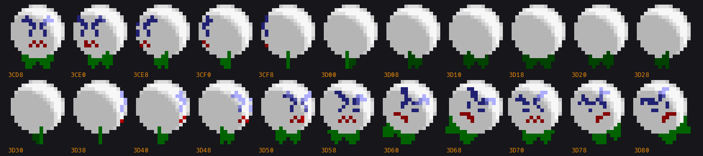

Yes, it does! There was indeed an original ornament! It's an angry white golf ball-looking little guy with a green bow tie (maybe). I don't *think* it's an existing characer or reference to anything, but maybe it's just too deep a cut for me. If you recognize him, let me know.

His graphics go entirely unused, abandoned in the graphics ROM. The only remnant of his existence in the final version is his palette, which is shared with the chain from which his usurper now dangles.

Let's restore him to his former glory:

World (`radm`):

```xml
  <cheat desc="Restore original ball ornament">
    <script state="on">
      <action>temp0=mainpcb:maincpu.mw@73d2c</action>
      <action>mainpcb:maincpu.mw@73d2c=0xC000</action>
      <action>temp1=mainpcb:maincpu.mw@73d32</action>
      <action>mainpcb:maincpu.mw@73d32=0x3CD8</action>
      <action>mainpcb:maincpu.mw@73DE9=0x3CD8</action>
      <action>temp2=mainpcb:maincpu.mw@73D39</action>
      <action>mainpcb:maincpu.mw@73D39=0x1320</action>
      <action>temp2=mainpcb:maincpu.mb@73DE2</action>
      <action>mainpcb:maincpu.mb@73DE2=0xF0</action>
      
    </script>
    <script state="off">
      <action>mainpcb:maincpu.mw@73d2c=temp0</action>
      <action>mainpcb:maincpu.mw@73d32=temp1</action>
      <action>mainpcb:maincpu.mw@73DE9=temp1</action>
      <action>mainpcb:maincpu.mw@73D39=temp2</action>
      <action>mainpcb:maincpu.mb@73DE2=temp3</action>
    </script>
  </cheat>
```

US (`radmu`):

```xml
  <cheat desc="Restore original ball ornament">
    <script state="on">
      <action>temp0=mainpcb:maincpu.mw@73d82</action>
      <action>mainpcb:maincpu.mw@73d82=0xC000</action>
      <action>temp1=mainpcb:maincpu.mw@73d88</action>
      <action>mainpcb:maincpu.mw@73d88=0x3CD8</action>
      <action>mainpcb:maincpu.mw@73e3f=0x3CD8</action>
      <action>temp2=mainpcb:maincpu.mw@073D8F</action>
      <action>mainpcb:maincpu.mw@073D8F=0x1320</action>
      <action>temp2=mainpcb:maincpu.mb@073E38</action>
      <action>mainpcb:maincpu.mb@073E38=0xF0</action>
    </script>
    <script state="off">
      <action>mainpcb:maincpu.mw@73d82=temp0</action>
      <action>mainpcb:maincpu.mw@73d88=temp1</action>
      <action>mainpcb:maincpu.mw@73e3f=temp1</action>
      <action>mainpcb:maincpu.mw@073D8F=temp2</action>
      <action>mainpcb:maincpu.mb@073E38=temp3</action>
    </script>
  </cheat>
```


# No Ornaments? - Rad Mobile Early Screenshots

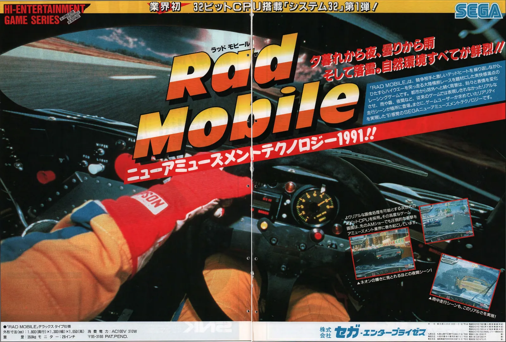

Advertising for the game began in January 1991, with the above two page spread appearing in the first edition of Game Machine for that year.

Of note are the screenshots included:

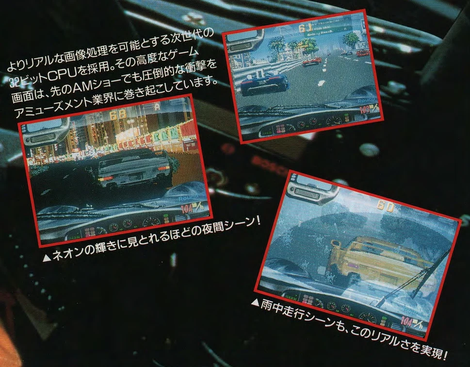

The most conspicuous difference is the lack of a rear-view mirror ornament at all. Aside from that, RANK is missing entirely from the upper right, and the ROUND indicator was originally located above the speed readout. Other than things are mostly identical.

What really catches my attention is the single A in the upper right of the screenshot on the left. That's rather... anomalous. I have a suspicion - with zero proof - that this is related to the unfinished name entry system. We'll talk more about that in the next section.

There was also an industry flyer for the game:

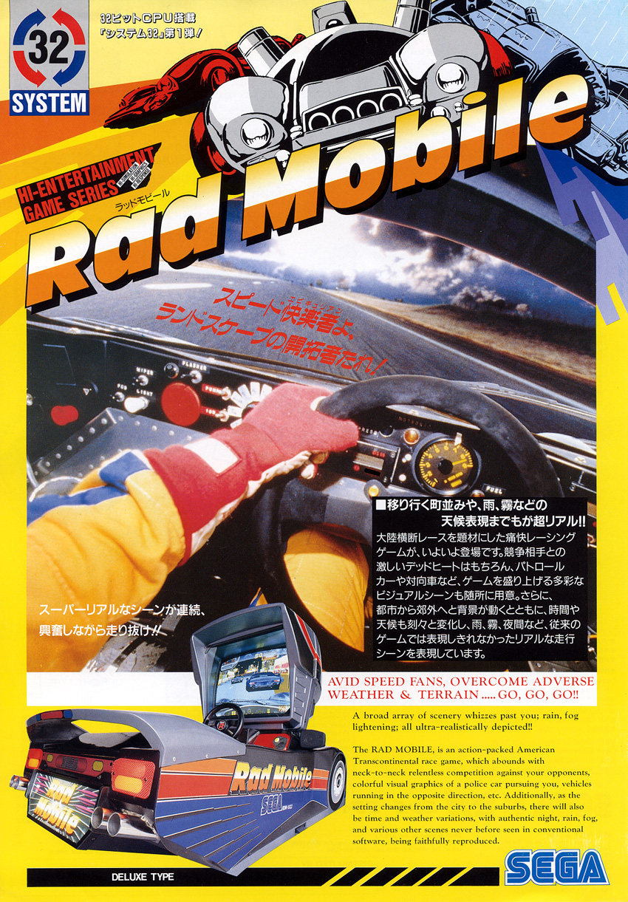

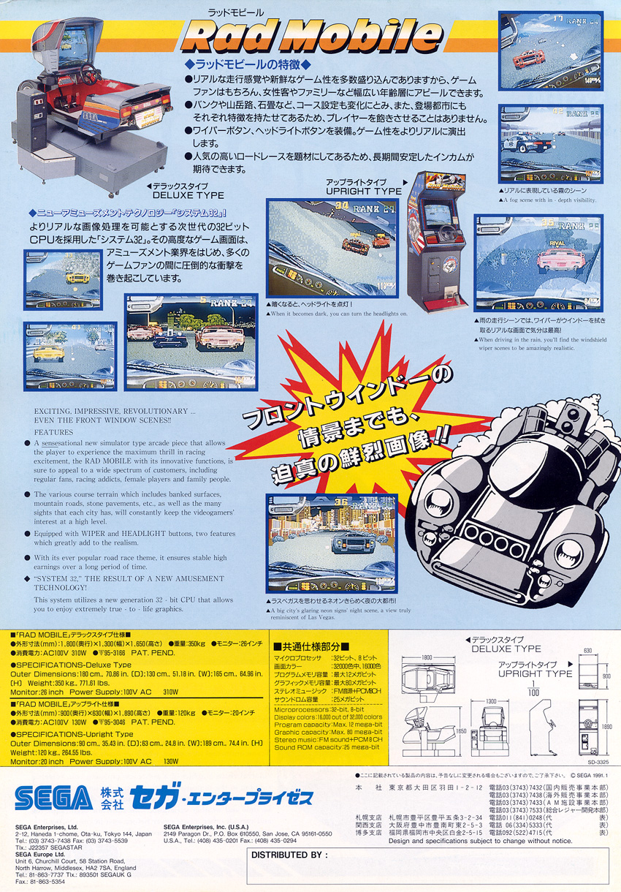

Here too there are screenshots, and notably, the RANK text is now present:

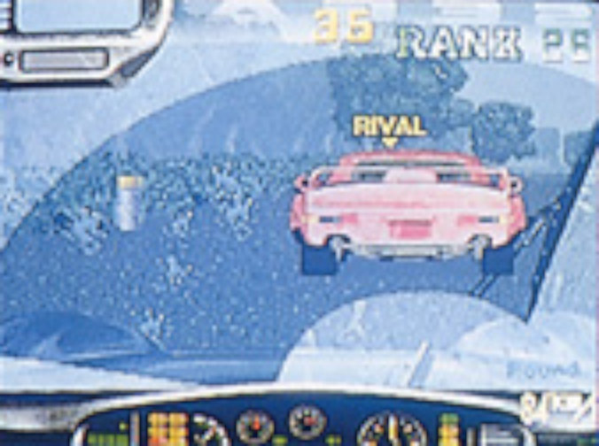

It is lacking the number ordinal at the end, however. The round text is still above the speed, and there is still no rear-view mirror ornamament.

But something I personally find more interesting abot the flyer is that it has an early version of the System 32 hardware logo on the front.


img/system32_old.svg | Older, printed on the Rad Mobile flyer
img/system32_new.svg | The final logo, printed on flyers for all later games


I think I prefer the final version, with its Helvetica-esque industrial-machinery-repair-manual aesthetic.


# Cut Rankings System

It seems that the whole concept of scoring in Rad Mobile was an afterthought: it lacks a high score list and it lacks a name entry screen to add to that list. The only real rating in the game is the overall race rank which determines the ending. And even then that may have been tacked on: I think it's telling that those early screenshots of the game do not have a ranking on screen.

But there are numerous remnants of a traditional score keeping system in the data, at varying stages of completion.

## Scorekeeping

At `0x70AD4` (World) / `0x70B2A` (US) is a function that takes a BCD value (binary coded decimal: a number that is used like human-readable base 10 within a computer-native, binary system) and adds that to a running value. In other words, it adds a number to a player's score. It also evaluates whether the new score is greater than the high score, putting the player at the top. Notably, for a reason we'll discuss in the next section, it clambs the maximum high score at 99,999,999. Immediately after that function is that prints the score at the top of the screen, with the high score a little further to its right - that classic style you see in so many arcade games of the 1980s.

Both routines are completely unused, and both are actually red herrings. Both appear functionally identical in Hard Dunk, where they also go unused. And several of the utilities nearby, which are things like common math routines, are also present in other System 32 games.

In other words, it looks like it came from a general purpose shared library for the hardware rather than being written specifically for this game. Which makes sense, because most racing games use lap times and placements instead of a traditional numeric points system.

## Ranking List

And yet, Rad Mobile has a working but unused high score list, *using that traditional numeric points system:*

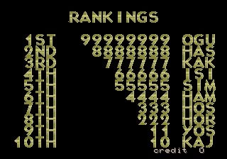

It is animated, displaying the names and scores as a wipe from top to bottom, with the only thing missing being its background. It is written to be a major game mode, yet it is disconnected from the mode jump table at `0x660F1`.

The default score table is copied over into RAM on every cold boot, from code at `0x75FFD`. That is the only remaining piece that still runs in the final code.

You may recognize that score in the default list top spot: 99,999,999. That's the max value that the unused points addition function above allows. It implies a connection between two unused pieces of code that further implies the point system was at least in consideration.

### Early Version of the Trans American Speed Race Marquee

If we were to call the rankings list code directly we would see...


img/radmu_ranking_replacement01.png
img/radmu_ranking_replacement02.png


... this. The "TRANS AMERICAN SPEED RACE" marquee scrolling by, but with no background race and no sound. After it's done, it continues to the rest of attract mode. There's no sign of a ranking list here.

Investigating we find there's something peculiar about this the sub-mode jump table:

<pre class="pdasm pdasm-arch-nec-v60" data-pdasm-caption="radmu (US)" data-pdasm-bases="R25=208000">
075D94: movz.bw 7006[R25]{sub_mode}, R0
075D99: jmp     75DA6[PC](R0)  ; the displacement puts the base at 0x75DA6
075D9D: br      75DAF{mode__ranking__sub0_init}  ; so this branch never gets called
075DA0: jmp     70E20{run_tasks}
075DA6: br      7604E{mode__ranking__sub0_alt_init} ; and this is always called
075DA9: jmp     70E20{run_tasks}
</pre>

The `JMP` at `0x75D99` sets its base to `0x75DA6`. This changes the indexing of the jump table: an index of 0 no longer references the first item anymore, but the third. So the first two entries in the jump table are entire skipped. 

It turns out the actual ranking screen initialization is in that first jump table entry, the one that is skipped. If we reset the displacement of the jump into the table to realign the indexing, the ranking screen runs instead.

What this *seems* like is that the developers patched in a call to this scrolling text to replace the ranking screen while keeping the attract mode filled out with something. They later decided to layer the marquee over some gameplay and completely removed the old version and the even older (and disabled) ranking screen with it.

### Restoring the Rankings

We can restore the ranking list pretty easily, actually. The disconnected code matches the pattern of other attract mode functions with its early escape if a credit is inserted, so it was almost certainly part of the attract mode rotation.

It likely fit somewhere between game mode 11 to 14, as these are identical and mostly empty routiunes that simply move to the *next* game mode. If you set mode 11, it will advance to 12, then 13, then 14, before reaching 15 which resets the attract loop.

*Technically,* modes 11 to 14 are in use in the final game. After the gameplay demo in attract mode or after a Game Over screen in game, mode 11 is set, which advances as described and eventually restarts the attract loop. So modes 11 to 14 were possibly planned or removed parts of the attract mode.

So let's just choose mode 11, since going immediately to the high score screen after a game over/gameplay demo is as good a choice as any.

The next problem is that the main mode jump table uses `BR`, whose address mode means that the ranking screen code is too far away. We need to set up a trampoline in some unused but reachable memory space that can bounce the CPU where we want it. We also need to realign the sub-mode jump so we get the actual ranking screen and not the marquee that replaced it.

Here are the cheats to do just that:

World (`radm`)

```xml
  <cheat desc="Restore the RANKINGS high-score screen">
    <comment>Restores the ranking screen to the attract mode loop</comment>
    <script state="on">
      <action>temp0=mainpcb:maincpu.mw@066113</action>
      <action>mainpcb:maincpu.mw@066113=8c7e</action>
      <action>temp1=mainpcb:maincpu.mq@05ED90</action>
      <action>mainpcb:maincpu.mq@05ED90=ffff00075d6af3d6</action>
      <action>temp2=mainpcb:maincpu.mb@075D46</action>
      <action>mainpcb:maincpu.mb@075D46=0x04</action>
    </script>
    <script state="off">
      <action>mainpcb:maincpu.mw@066113=temp0</action>
      <action>mainpcb:maincpu.mq@05ED90=temp1</action>
      <action>mainpcb:maincpu.mb@075D46=temp2</action>
    </script>
  </cheat>
```

US (`radmu`)

```xml
  <cheat desc="Restore the RANKINGS high-score screen">
    <comment>Restores the ranking screen to the attract mode loop</comment>
    <script state="on">
      <action>temp0=mainpcb:maincpu.mw@066113</action>
      <action>mainpcb:maincpu.mw@066113=8c7e</action>
      <action>temp1=mainpcb:maincpu.mq@05ED90</action>
      <action>mainpcb:maincpu.mq@05ED90=ffff00075d6af3d6</action>
      <action>temp2=mainpcb:maincpu.mb@075D9C</action>
      <action>mainpcb:maincpu.mb@075D9C=0x04</action>
    </script>
    <script state="off">
      <action>mainpcb:maincpu.mw@066113=temp0</action>
      <action>mainpcb:maincpu.mq@05ED90=temp1</action>
      <action>mainpcb:maincpu.mb@075D9C=temp2</action>
    </script>
  </cheat>
```

## Name Entry

Functionality for the other half of a rankings list - the name entry - does not appear to be present at all in the game. This is particularly amusing because the game's official soundtrack lists track 8 as "Name Entry."

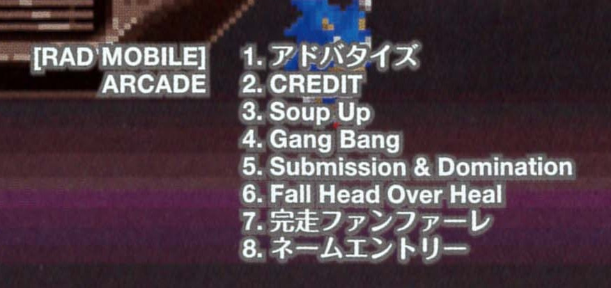

It's the music that plays at the very end, with the American flag background and Statue of Liberty/fat cop, depending on your ranking.

A name entry screen was at least on the team's mind, however.



The font used on the ranking screen has a few glyphs in the top row that seem to be specifically for name entry: left and right arrows and END. There's also a cute GOOD LUCK and car icon among the selectable characters, proably "decorations" for the name.

Interestingly, it also has explicit ordinals (st, nd, rd, th) which go unused on the ranking screen - the standard large ASCII characters are used there instead.

I have a suspicion that if name entry had been implemented, it would have been similar to how Gale Racer eventually implemented it: register your name *before* the start of the race. 


The only maybe-possibly support for this is those early screenshots from that first ad. The screenshot on the left has a prominent letter A in the top right. Perhaps the name you entered would show there, and the dev just hit A to continue on quickly. On the other hand, that could just as easily be some kind of debug readout or even a bug, so don't take this as anything more than me wondering out loud.

# Unusual Input Code

There is a rather peculiar input code in the game...

During the gameplay demo inm attract mode, enter this code:

```
LIGHTS, WIPERS, WIPERS, WIPERS, LIGHTS, LIGHTS, LIGHTS, LIGHTS, WIPERS, WIPERS, LIGHTS, WIPERS, WIPERS, LIGHTS, LIGHTS, WIPERS
```

Doing so adds a Sega logo at the bottom and the text "Rad Mobile."


img/radm_code_before.png | Before
img/radm_code_after.png | After


And... that's it. It doesn't set any flags in RAM, it just calls a display script that loads the Sega graphic and writes the text.

I uh, don't really have any theories about this one. While not an overly complex code, the result just seems kind of... underwhelming for 16 button presses.


# Unused Hand Animations

After getting in to the race car, the driver pulls on a pair of black racing gloves. This is the only time you see his hands in the game. Yet there are three additional hand animations that go unused.

## Lights/Wipers Assist


img/radm_hands_low1.png
img/radm_hands_low2.png


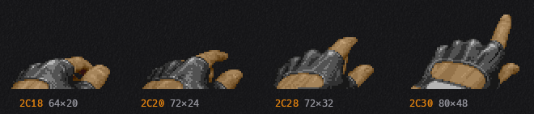

The hand raises into view but stays low in the frame, the forefinger extended.

This animation actually has code associated with it. There is a jump table at `0x74979` (US)/`0x74923` (World) which switches on the state of the hands task. The first four entries in this table are init/loop pairs using this hand graphic: the first set animates it on the left side, and the second on right.

The code doesn't just animate the frames, though. The first sets the Wipers bit on the players controls, while the second sets the Lights bit. In other words, it's simulating a button press. This could be read a couple ways: an example of the button usage during the attract mode, perhaps, or my preferred take: you waited too long in the dark or rain and the driver is now doing it *for you.*

The hand task is never called with either either of these init states, however, effectively making them unused. There isn't a graceful way to re-implement them, but a quick way to see them in motion is just replace the initial gloves animation with these

World (`radm`):

```xml
  <cheat desc="Unused hand animation: button push left">
    <comment>Replaces the gloves animation when starting the race.</comment>
    <script state="on">
      <action>temp0=mainpcb:maincpu.mb@067BF2</action>
      <action>mainpcb:maincpu.mb@067BF2=0xE0</action>
    </script>
    <script state="off">
      <action>mainpcb:maincpu.mb@067BF2=temp0</action>
    </script>
  </cheat>

  <cheat desc="Unused hand animation: button push right">
    <comment>Replaces the gloves animation when starting the race.</comment>
    <script state="on">
      <action>temp0=mainpcb:maincpu.mb@067BF2</action>
      <action>mainpcb:maincpu.mb@067BF2=0xE1</action>
    </script>
    <script state="off">
      <action>mainpcb:maincpu.mb@067BF2=temp0</action>
    </script>
  </cheat>
```

US (`radmu`):

```xml
  <cheat desc="Unused hand animation: button push left">
    <comment>Replaces the gloves animation when starting the race.</comment>
    <script state="on">
      <action>temp0=mainpcb:maincpu.mb@067BE6</action>
      <action>mainpcb:maincpu.mb@067BE6=0xE0</action>
    </script>
    <script state="off">
      <action>mainpcb:maincpu.mb@067BE6=temp0</action>
    </script>
  </cheat>

  <cheat desc="Unused hand animation: button push right">
    <comment>Replaces the gloves animation when starting the race.</comment>
    <script state="on">
      <action>temp0=mainpcb:maincpu.mb@067BE6</action>
      <action>mainpcb:maincpu.mb@067BE6=0xE1</action>
    </script>
    <script state="off">
      <action>mainpcb:maincpu.mb@067BE6=temp0</action>
    </script>
  </cheat>
```

## Pointing / Alternate Button Push

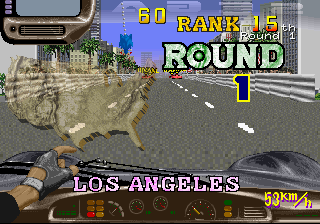

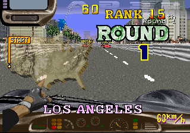

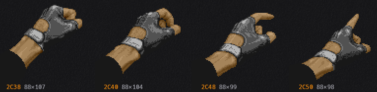

Here we have a fist unballing to a pointer finger. It could be construed a couple ways: pointing off into the distance, or another button press.

It's a bit hard to say, since these graphics are *not* used by any code, so we can't guess at what kind of functionality it may have had. There is also animation script for this hand, so we can't properly restore it like the button press animations.

## Rude Gesture

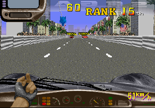

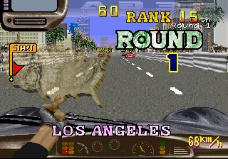

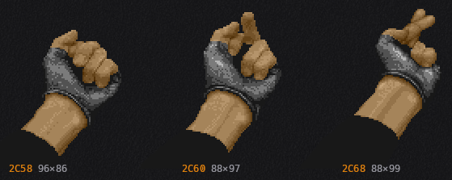

In a game with a 'tude like Rad Mobile it's not surprising to find what looks to be a variation of flicking off a passing car.

However, the third frame has the fingers crossed. I thought this may have been an international variant, but web searches didn't turn anything up.

It *may* be a censored version. Perhaps the second and third frames are not actually connected, that there are only two frames in the animation: the wind-up and then either the actual bird or the "safe" version.

Unfortunately, like the pointing animation, this is not used by any code and has no animation data associated with it, so we'll have to settle for just the graphics alone.

# Throwing a RAD DRINK

Another feature of the game that you've (probably) never seen is rival cars throwing a RAD DRINK at you during the race.

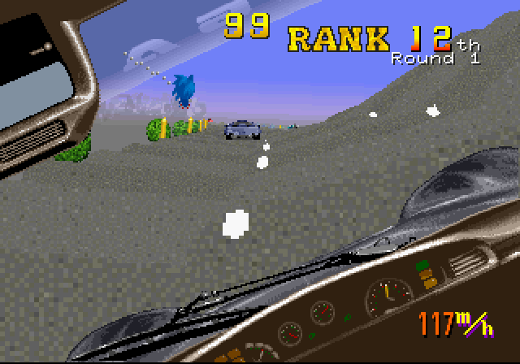

The code for this is in the game and live during the race... but it is (probably) never actually used due to a bug.

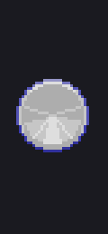

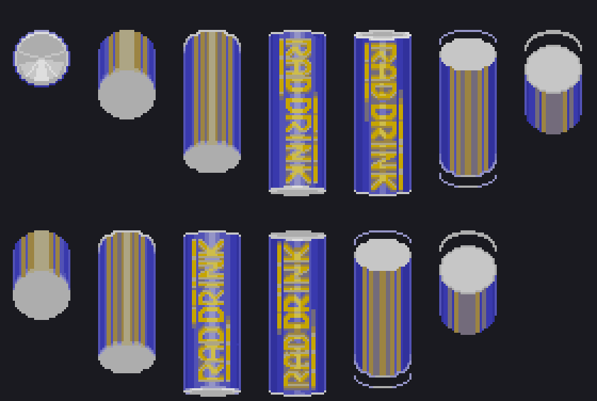

There is a 50% chance that a rival car will launch one at you when they are a certain distance in front of you. The can flies straight at your windshield, but there is no effect on the game - no cracked screen, no slowdown, no crashing. The only other effect is that it plays sound effect 0x96... which is silent anyway.

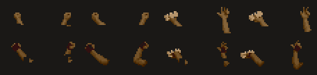

Near the can's graphics are a set what look to be two variations of arms reaching out the window that go unused. (This palette is probably incorrect, but it was the only one that looked plausible.) There are two versions of what look to be throwing a can backwards. Given the angles, it looks like one is thrown from out the driver side window and the other is thrown up from the sunroof. There is even an cutout on the gloved variant where it would occlude with the rear wing on the car. So it seems like their were plans to make the drink throw a little more detailed.

The other gestures are little unclear. Perhaps fist meant to hold an overlaid object, and perhaps a muscle flexing gesture.

We'll go into way more detail about why the can is (probably) never seen in game in just a moment, but to cut straight to the chase (heh), here's the cheat to restore it:

World (`radm`)
```xml
  <cheat desc="RAD DRINK throw restore">
    <script state="on">
      <action>temp0=mainpcb:maincpu.mb@06edab</action>
      <action>mainpcb:maincpu.mb@06edab=24</action>
    </script>
    <script state="off">
      <action>mainpcb:maincpu.mb@06edab=temp0</action>
    </script>
  </cheat>
```

US (`radmu`)

```xml
  <cheat desc="RAD DRINK throw restore">
    <script state="on">
      <action>temp0=mainpcb:maincpu.mb@6ee01</action>
      <action>mainpcb:maincpu.mb@6ee01=24</action>
    </script>
    <script state="off">
      <action>mainpcb:maincpu.mb@6ee01=temp0</action>
    </script>
  </cheat>
```

## RAD DRINK Analysis

Each car on the road has an "effect" attached to it. This can be environmental effects, like splashes from the rain or dust from the desert drawn on the back of the car; or it can be race events, like a barrel roll into a crash and the chance to throw a can out the window.

It has two code dispatchers to manage these effects: one for the "decision making" phase (game logic) and one for the "application of those decisions" phase (drawing to the screen, playing sounds, etc). The one at `0x6ED5B` (World) / `0x6EDB1` (US) is for game logic, switching on the effect type and state to determine if the car should do something special.

Case 0 of this switch is "Should we throw a can?" This is where things get tricky.

<pre class="pdasm pdasm-arch-nec-v60">
06EDA2: test.b  38[R20]{traffic_obj->effect} ; Does the effect byte == 0 (effect id 0, iter 0)?
06EDA5: bne     6EDCE  ; no - skip the rest of the code
06EDA7: test.b  27[R20]{traffic_obj->variant}  ; Is the car a rival?
06EDAA: bge     6EDCF ; no - skip the rest of the code and don't check again
06EDAC: mov.w   4C[R20]{traffic_obj->course_pos}, R0  ; get the car's position...
06EDB0: sub.w   7482[R25]{player_pos_in_course}, R0  ; and subtract the player's position...
06EDB5: mov.b   #0, R0  ; round to the nearest road strip
06EDB8: cmp.w   #3200, R0  ; is the car 50 road units away from the player?
06EDBF: bne     6EDCE ; no - skip the rest of this code
06EDC1: test.h  D80000{hardware_rng} ; get a random value...
06EDC7: bn      6EDCF  ; and check if it's negative: a 50/50 coin flip
06EDC9: mov.b   #6, 38[R20] ; coin flip passed; set the effect to throw a can
06EDCE: rsr
06EDCF: mov.b   #8, 38[R20] ; coin flip failed; exit and don't come back
06EDD4: rsr
</pre>

The effect byte is actually two bit fields: the low 3 bits are the effect ID (meaning there are a maximum of 8 effects supports), while the rest of the upper bits are step counters or parameters used by the effect.

So there are four checks that must pass for a can throw to happen:

 - it must be effect id 0, step 0
 - it must be a rival car
 - it must be 50 "strips" of road ahead of the player
 - it must pass a "coin flip."

The first check passes for most cars. State 0 is essentially idle, so this just verifies the car doesn't already have some effect going on. Most cars are spawned this way from the traffic manager. When they aren't, it's an environmental effect, like rain splashes.

The second check narrows things down substantially: the car type must be rival. These are, obviously, the ones in the game with the RIVAL marker above them. Their internal ID is a negative value, hence the simple `TEST`/`BGE` to make the determination.

The next check simply verifies that the rival car is far enough in front of you to run the animation - 50 road "units," which are the scaled horizontal strips that make up the track.

And finally, there's a simple random number check to add some variability: go through with throwing the can if the random number was positive, and stop if it was negative. Basically, a 50/50 coin flip.

So in the very first iteration of a newly spawned car, it enters the effect manager. Most cars spawn with their effect byte set to 0 - so the first check passes. But now we're at the second check: is the car a rival?

The bug lies in the fact that cars are not assigned a type when they are first created. Traffic is derived from the stage's spawn table, where each entry names a point on the course and how many cars to release there. Several may be created at once, so to stop them all popping into view on the same frame each is given a small staggered delay. It's one frame for the first, eight for the second, fifteen for the third, and so on.

Of the cars that spawn, *some become rivals*: any car that appears at or behind you becomes one automatically, since it will be coming past you, while a car appearing ahead of you only becomes a rival if the game still needs more of them to fill out the field in front. That quota of rivals is derived from your current rank.

Crucially, that determination about which cars become arrivals does not until after the appearance delay, some number of frames after spawning. So back to the question we posed, on the *first frame* of running, at the second check, is the car a rival?

No, because the appearance delay has not yet passed and the rival assignment has not yet occurred. This is the bug: **It is impossible for any car spawned with effect byte 0 to ever throw a can, even if they are a rival.**

Now, there is a *secondary* quasi-bug that theoretically (and ironically) could cause a RAD DRINK can to spawn. Courses with wet roads - either from active rains or puddles on the road - cause water sprays behind the car. This is one of the environmental effects mentioned above.

When a splash effect is done, it resets the effect byte to 0 - the idle state that doubles as the can throw decider. In that case, the car has already appeared and the rival assignment has already completed, so it skips past the bug described above. If it stays in state 0 (that is, no more splashing to change the effect state again) and reaches 50 road units in front of the played and then passes the coin flip at that point, then a can would be thrown.

This has yet to be actually observed, but our understanding of the code so far says it *could* happen in a round-about buggy way.

## Fixed in Gale Racer

"But wait!" you exclaim. "I swear I've seen this can being thrown before!"

You were probably playing Gale Racer, where the can throw was fixed and even the sound effect was restored (it's a dull clang, like a metal basebal bat, unsurprisingly). And you'll see it more often there as well, since there is no 50/50 coin flip - it must simply be a rival car within range that hasn't already thrown.

# BONUS: All Traffic Variants

Because I needed to narrow down what exactly the car variants were for the can throw (before I realized it was just the rivals), I ended up enumerating them all.

[So here's a handy reference sheet](img/radmu_traffic_types.jpg).

# Unused Barrel Roll Crash

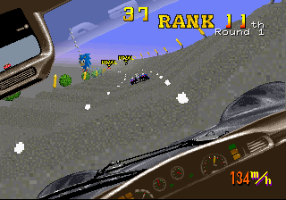

Another effect in the same table as the RAD DRINK can throw is a car barrel rolling into a crash, which causes an obstacle for you.

It is full implemented in the code - 0xB4 is the course script code - but no courses ever reference it, making it unused.

It is limited to the "open cockpit racer" style of vehicle as that is the only with the animation set. And similar to the can throw, it is locked behind a random number 50/50 coin flip to determine if the roll actually happens.

# Unused Dust Spray

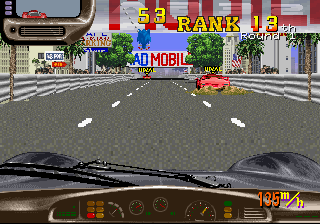

Yet another unused effect: dust clouds from behind a vehicle. Like the barrel roll, it has a defined course script code (0xC3). It seems likely it would have been used in a desert stage, but for whatever reason, none of the courses use it.

# Unused Wiper/Lights Messages

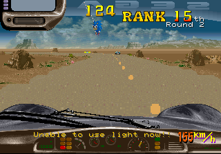

Yet another implemented but unused function: pressing the Lights button when it can't be used shows a flashing message saying as much.

There is a matching string for the wipers as well:

```
Unable to use wiper now!!
```

It is not used by any code, however.

There isn't an easy way to restore the message, and since it's such a small thing we're going to skip trying to cook up a cheat for it.

# Unused Sound Effects and Sound Test Cheat

There are a handful of voice clips that are never referenced in code or data.











You may have noticed that Rad Mobile does not have a sound test to begin with. We can hack one in by putting a sound code at the head of the driver's ring queue and resetting its pointer to the front.

And here's a cheat to do just that, which works in both versions. Note that the last sound ID in the table is 0xD9, hence the max value in the cheat.

```xml
  <cheat desc="Sound Test Hack">
    <comment>Send a sound code to the audio driver; use on the Service Menu screen for a quiet background</comment>
    <parameter min="0x80" max="0xD9" step="1"/>
    <script state="change">
      <action>mainpcb:maincpu.pb@20E992=param</action>
      <action>mainpcb:maincpu.pb@20E990=0x00</action>
      <action>mainpcb:maincpu.pb@20E991=0x01</action>
    </script>
  </cheat>
```

# Region Differences

We have a US and World dump of Rad Mobile; conspicuously missing is a Japan region dump.

One almost certainly exists. Both dumps carry a standard "This Game Is For Japan Only" screen with working (but unused) code. The flyer for the game (as we saw above) was distributed with both English and Japanese. And perhaps most compelling, the existence of the RIVAL marker written in katakana among the graphics:



There is also a Japanese version of the "Trans American Race" marquee that scrolls in the attract mode.



アメリカ大陸横断レース *America Tairiku Oudan Race*

Of course, it's possible a Japanese version was planned and not released, hence why I hedged with *almost* certainly, but far more realistically is that a Japanese board hasn't been dumped/added to MAME yet.

So what's different in the two dumps we do have?

Aside from the inclusion of the Don't Do Drugs screen in the US version, the only change is the speedometer readout:

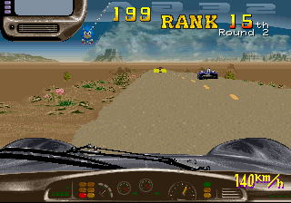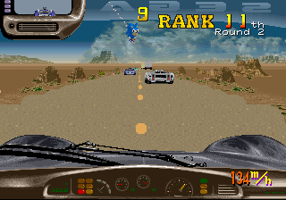

Predicatbly, the World version displays units in `km/h` while the US displays it as `m/h`.

The raw speed value is stored at `0x20F4A0`. This is the *actual* speed of the car as used by the game's physics, which are identical across both regions. What is different is how that speed is *displayed*.

Here is how the World release does it:

<pre class="pdasm pdasm-arch-nec-v60" data-pdasm-caption="radm (World)">
0676C2:  movz.hw 74a0[R25]{raw_speed}, R0
0676C7:  cmp.h   #140, R0             ; compare raw speed to 320
0676CC:  bl      000676e1               ; below 320: fall straight through to the shift
0676CE:  sub.h   #140, R0
0676D3:  mul.h   #d4, R0                ; multiply speed by 212
0676D8:  shl.h   #fa, R0                ; >> 6 (divide by 64)
0676DC:  add.h   #140, R0             ; add 320
0676E1:  shl.h   #fe, R0                ; >> 2 (divide by 4)
0676E5:  jsr     00070bf0{gfx__draw_number}
</pre>

We can rewrite this a bit to:

`raw_speed` < 320 ? `raw_speed` / 4 : ((((`raw_speed` - 320) * 212) / 64) + 320) / 4

If the raw speed is below 320, simply divide that numnber by 4 and display it as the speed in km/h. If it's past that threshold, the value *above* 320 is multiplied by ≈3.3, re-added back to the base 320, and finally the "reconfigured" value is divided by 4 to yield the final display number.

In other words, the displayed speed rises faster after hitting that 320 base speed. The raw speed value is capped at 433, and you hit 320 pretty quickly and stay above it pretty steadily in the game while holding the accelerator. So the World version (and presumably the Japanese version) is hand tuned to show a faster speed as it nears that ceiling.

<pre class="pdasm pdasm-arch-nec-v60" data-pdasm-caption="radmu (US)">
0676CA:  movz.hw $74a0[R25]{raw_speed}, R0
0676CF:  mulu.h  #$1e, RH0                   ; multiply by 30
0676D4:  divu.h  #$60, RH0                   ; divide by 96
0676D9:  jsr     $00070c46{gfx__draw_number}
</pre>

The US version on the other hand is a simple `raw_speed` * 30 / 96. Much simpler but, ironically, more truthful about what you're actually seeing on screen.

Rad Mobile's stages are laid out in strips, with each strip magnified the closer you get to it. That's what give the game it's 3D effect as a "super scaler": many elements on screen are quickly scaled relative to your position, giving a sense of depth.

The value at 0x20F48C counts the number of strips passed in a *tick*. So in a way, it's a speedometer itself.

A tick, in this case, is a full iteration of the game's main loop. The video updates at 60 Hz, but the main loop only runs at 30. So in order to be accurate with our terminology, a frame is a video screen update, 60 times a second; a tick is a main loop iteration, 30 times a second.

That accounts for the 30 as the multiplier 

Determining the meaning of 96 is less obvious. If we sample both the "strips per tick" value and the raw speed over time, and then divide each raw speed value by 96, we would find that value aligns very closely with the strips per frame value. That tells us that 96 is a constant corresponding to the "length" of each strip.

Another way to think of it is every 96 units of raw speed is equal to clearing one strip in one tick.

So the formula scales the raw speed by 30 (number of ticks per second) and divides by 96 (speed units per frame), giving us **strips passed per second**.



In short: the World version uses a hand-tuned formula to display a number that ramps up faster once you reach a certain speed, while the US version gives a more technical read of what is going on on screen. And to reiterate: this is all for the number display only: the actual speed and the phyics that use that speed are identical in both versions.

# Cabinet Differences

Rad Mobile shipped in two formats: an upright cabinet and a deluxe, motorized sit-down.

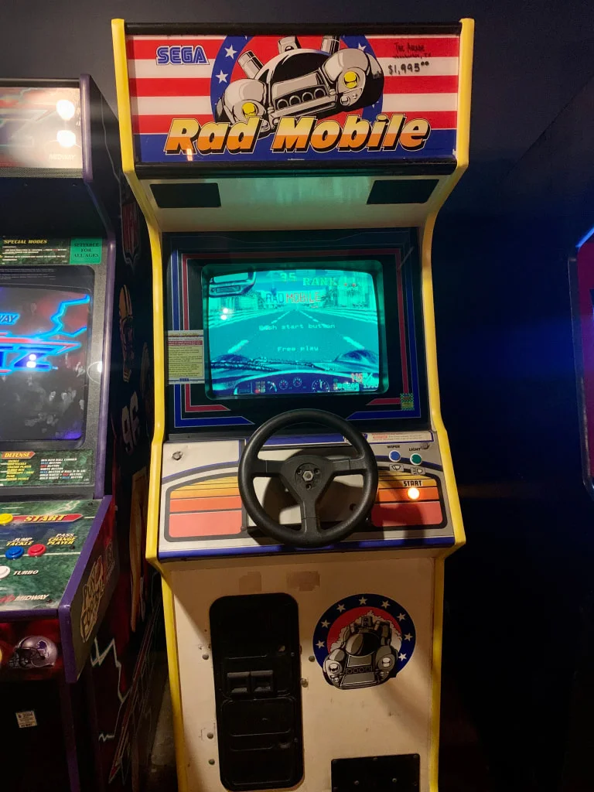

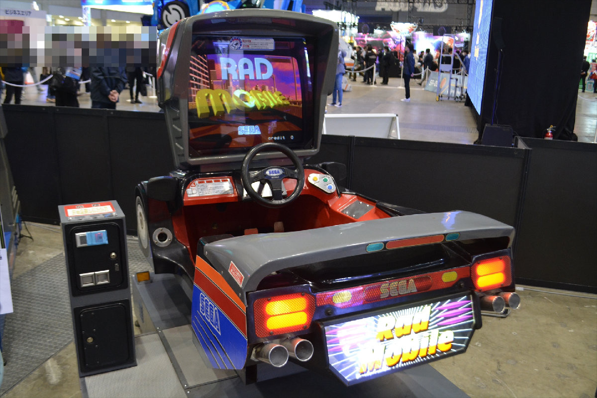

The game itself is identical in both versions, except for one small detail:

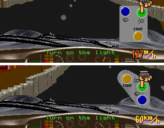

The lights/wipers buton panel has a diferent design on the two cabinets, and the game reflects that.

Well, there is one further difference: the deluxe edition has a movement motor which MAME does not emulate. If you select Deluxe in the service menu's Game Settings, you'll be met with a Motor Warm Up Now screen that never goes away.

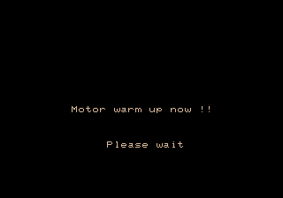

You can use this cheat to shut up the motor driver and get into game (though you'll still have some sensor error messages on screen):

World (`radm`):

```xml
  <cheat desc="Skip motor messages on startup in deluxe cabinet">
    <comment>MAME does not emulate the deluxe cabinet motor drive board; this will get past the startup message</comment>
    <script state="on">
      <action>temp0=mainpcb:maincpu.mb@068242</action>
      <action>temp1=mainpcb:maincpu.mb@06837F</action>
      <action>temp2=mainpcb:maincpu.mb@0674F3</action>
      <action>mainpcb:maincpu.mb@068242=02</action>
      <action>mainpcb:maincpu.mb@06837F=6A</action>
      <action>mainpcb:maincpu.mb@0674F3=6A</action>
    </script>
    <script state="off">
      <action>mainpcb:maincpu.mb@068242=temp0</action>
      <action>mainpcb:maincpu.mb@06837F=temp1</action>
      <action>mainpcb:maincpu.mb@0674F3=temp2</action>
    </script>
  </cheat>
```

US (`radmu`):

```xml
  <cheat desc="Skip motor messages on startup in deluxe cabinet">
    <comment>MAME does not emulate the deluxe cabinet motor drive board; this will get past the startup message</comment>
    <script state="on">
      <action>temp0=mainpcb:maincpu.mb@068236</action>
      <action>temp1=mainpcb:maincpu.mb@068373</action>
      <action>temp2=mainpcb:maincpu.mb@0674FB</action>
      <action>mainpcb:maincpu.mb@068236=0x02</action>
      <action>mainpcb:maincpu.mb@068373=0x6A</action>
      <action>mainpcb:maincpu.mb@0674FB=0x6A</action>
    </script>
    <script state="off">
      <action>mainpcb:maincpu.mb@068236=temp0</action>
      <action>mainpcb:maincpu.mb@068373=temp1</action>
      <action>mainpcb:maincpu.mb@0674FB=temp2</action>
    </script>
  </cheat>
```

# Source Code Remnants in the Z80 Data

`epr-13686.bin` is 32 KB of Z80 code that is unemulated. It is the motor control for the deluxe cabinet, and it has fragments of source code text scattered throughout,

From `0x3100` to `0x42FF`, every 256-byte page consists of 8 zero bytes followed by 248 bytes of source text. That is why words are clipped — e.g.
`LD (ENC_1),HL` runs straight into `NC_1S),HL`, having lost the eight bytes `\t\tLD\t(E` at the page boundary. Removing the zero runs reconstructs a mostly readable ~4.3 KB listing.

The source covers the deluxe cabinet's control loop: resolver/encoder integration, timer setup, PWM power and a cabinet-error handler, which is the routine behind the motor error strings seen in the Cabinet Differences section. There are also large blocks of text from the using MIFES, a PC-9801 text editor in which the source was likely being edited, and references to an ICE (in-circuit emulator) for testing.

Perhaps the most interesting piece is the credits plate, included as part of the source code file.

```
;-----------------------------------------------------------------------------
;O	*RAD MOBILE DELUXE CABINET MOVING CONTROL.			     O
;O			CABINET DESIGN	BY	ASATA.HIRAI		     O
;O			MECHANIC DESIGN	BY	MASAO.YOSHIMOTO		     O
;O				    AND NORIAKI.UEDA   		     O
;O			CABINET.PRODUCT	BY	MASAKI.MATSUNO 		     O
;O					    AND	FUTOSHI.ITOH		     O
;O			ELECTRIC DESIGN	BY	MASAYUKI.OSADA   	     O
;O                                          AND NOBUYUKI.KADOI               O
;O			HARDWARE DESIGN	BY	MASAYUKI.OSADA		     O
;O									     O
;O		MOTOR CONTROLER PROGRAM	BY	MASAYUKI.OSADA    	     O
;O		GAME		PROGRAM BY	AM R&D 3rd.		     O
;O									     O
;--------------------------------------------------------------------
```

A nearly identical block exists in the data at 0x60:

```
RAD MOBILE DELUX CABINET MOVING CONTROL. CABINET DESIGN    BY ASATA.HIRAI MECHANIC DESIGN BY MASAO.YOSH
IMOTO AND NORIAKI.UEDA CABINET.PRODUCT BY MASAKI.MATSUNO AND FUTOSHI.ITOH SEGA AM R&D 4th ELECTRIC DESIGN BY MASAYUK
I.OSADA AND NOBUYUKI.KADOI HARDWARE DESIGN BY MASAYUKI.OSADA MOTOR CONTROLER PROGRAM BY MASAYUKI.OSADA GAME PROGRAM 
BY AM R&D 3rd.
```

This was included intentionally, though, unlike the source code plate which just happened to be in a dirty buffer in memory. The only real difference (aside from the DELUX typo) is the inclusion of AM R&D 4th as the hardware designers, specifically diferentiating themselves from the game programmers in AM 3.

If you like, you can dig deeper with the [recovered source code text and analysis here](epr-13686_source_fragment.txt).

# System 32 demo remnants

Rad Mobile is also notable for being the first game on the System 32 hardware and thus the first Sega game on a 32-bit CPU, the NEC V60.

So it's no surprise that the game was probably started from a System 32 SDK example.

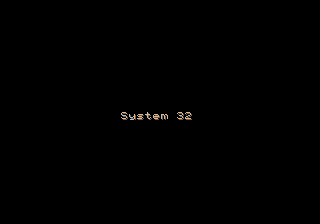

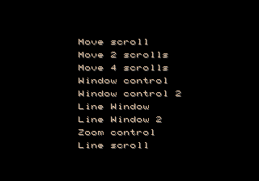


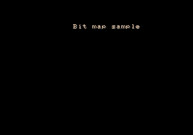

Immediately following the Japan warning screen, at 0x6CC31 in World and 0x6CCC27 in US, there is an array of strings of what appear to be the remnants of a System 32 demo or skeleton project. All the strings include a VRAM offset (that is, X/Y positioning) and palette index header, but there no code that references them and no other data that seems to be related. Nothing to give any further clues or context.

Among the text, there is a menu or list with terms relating to the graphics planes and windows, headers for example screens, and a simple "System 32" line. There is another string much later at 0x70D5A (World)/0x70DB0 (US) that has identical VRAM/palette headers that may also be part of this set:

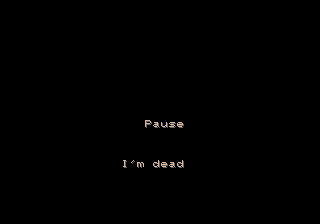

My guess is these were in resource files, seperate from the actual demo code, and while the code was removed or skipped, the data files were missed and compiled in.

There's not much else we can really glean from this, unfortunately. The same text appears in Rad Rally (which makes sense as the Rad Mobile "sequel") and Hard Dunk, for whatever that is worth.

I'm burying the lede here... What actually makes this interesting and notable is the very first string in the list:

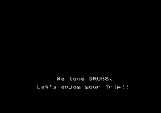

I really, really wish there was some actual code leftover just so I could get an explanation for whatever this is about.

So, first of all, drugs are considered really *bad* in Japan. The kids in 1960's/70's Japan weren't having a drug revolution like the US; they were busy protesting [terrible university conditions](https://en.wikipedia.org/wiki/Assassination_of_Inejir%C5%8D_Asanuma), [the presence of US military bases](https://en.wikipedia.org/wiki/Anpo_protests) and [the construction of Narita airport](https://en.wikipedia.org/wiki/Sanrizuka_Struggle).

As such, there has never been a societal acceptance of even "casual" drugs like marijuana. Even today, a miniscule amount of weed can effectively end your schooling, your career, your prospects for a good life in Japan.

So seeing something like this, a very direct and clear reference to drug use, in a Japanese corporate product, piques my interest. I don't think whoever wrote it was actually a drug user. It's very clearly a joke, and it's not like it was meant to ever be visible by consumers, but it's still an interesting choice to make...

So let's scrape the barrel for any context. The drug lines appear as two seperate strings, positioned sequentially in the lower-middle part of the screen. That positioning is familiar, right?


And with the Sega System 32 logo looking like this...

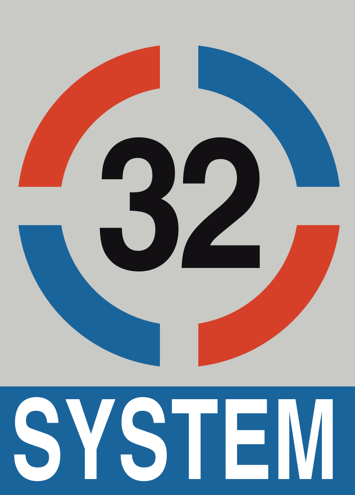

I can imagine there being some kind of parody of the FBI screen on the demo's startup.

Another, less interesting interpretation involves a string near it reading "128 Color banks."

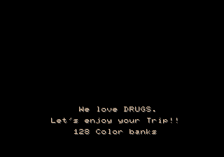

Its positioning metadata puts it right in the center and right below where the drugs lines would be. It could be it was running some kind if flashing, cycling, "psychadelic" color demo...

I wish I knew for sure.

# A Rush Job

The feeling I have after having spent so much time in the internals of this game is that the development team (and probably more loudly, management) said, "let's just get this thing out the door." There are probable bugs (like the tricky Flicky select code) and definite bugs (like the impossible RAD DRINK can throw), quick patches (like the text marquee to initially replace the rankings), cut functionality (like the name entry) and half-finished elements (like the extra hand gestures).

The feels like they were off to a great start with solid gameplay, but ended up running out of time before finishing all the bells and whistles that bring polish to a game. That's a tale as old as time in game development, but it feels acute in Rad Mobile.

There may be a reason for it.

In [Game Machine #388](https://onitama.tv/gamemachine/pdf/19900915p.pdf), the cover story is Sega's announcement of their new, powerful arcade hardware, the System 32. The first sentence proclaims that this will be not just the first 32-bit Sega video game, but the first 32-bit CPU used in any arcade machine *in the world.* Planning for a 32-bit machine began with the release of the 16-bit Mega Drive in 1988, it explains, with the logic being that the arcade should always be a step ahead of the home consoles.

The last section announces only one game: a driving simulator, still in development, with a target sales date of January 1991. It further says the game won't be ready for display at the 28th AM Show in early October, and Sega will only have the system board on display.

So here we have Sega heavily touting the first arcade game in the world on a true 32-bit CPU, the NEC V60, while at the same time there is so far only one game and it's not even ready for an industry trade show demo happening in less than a month from the announcement. And it will all be available for sale in just four months.

That seems like a tight schedule and a lot of pressure on the Rad Mobile staff. A major technological milestone for your company, and the *only* game for the hardware is not even demo worthy, with only four months left to complete, QA test, *and* mass produce it.

Suddenly the bugs and the trimmed content makes more sense.

Of course, I'm judging all this off of one article and I'm sure the reality has a bit more nuance to it. Nonetheless those are clear statements made by Sega at the time and they shine some light on the state of the game so close to its release.

---

That's it? Are we done? We've peeked in every dark corner of Rad Mobile's data? I think so! Until next time...
